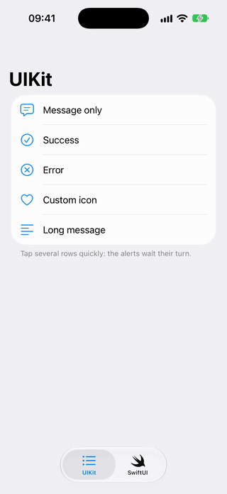

# JonAlert

[](https://swift.org)
[](https://developer.apple.com/ios/)
[](https://swift.org/package-manager/)
[](LICENSE)

A feedback alert for iOS, in the style of Spotify's. A short message, with an optional icon, appears
in the middle of the screen and fades away. Works with UIKit and SwiftUI.



- Alerts show one at a time. When several arrive together, they wait their turn instead of stacking.
- `show(in:)` returns once the alert has disappeared, so you can act right after it.
- VoiceOver reads the message aloud.
- Respects Reduce Motion, Dynamic Type and dark mode.
- No dependencies.

## Installation

In Xcode, choose **File → Add Package Dependencies…** and enter:

```
https://github.com/jonSurrey/JonAlert
```

Or add it to `Package.swift`:

```swift
.package(url: "https://github.com/jonSurrey/JonAlert", from: "2.0.0")
```

## Usage

```swift
import JonAlert

FeedbackAlert("Link copied")
FeedbackAlert("Added to your library", icon: .success)
FeedbackAlert("Couldn't connect", icon: .error)
FeedbackAlert("Added to favorites", icon: .custom(heartImage))
FeedbackAlert("Playlist saved", duration: .seconds(2))
```

An alert stays fully visible for its `duration` (one second by default), plus a short fade in and out.
A custom image keeps its own colors unless its rendering mode is `.alwaysTemplate`.

### UIKit

```swift
Task {
    await FeedbackAlert("Saved", icon: .success).show(in: view)
}
```

The alert appears in the window of the view you pass. Because `show(in:)` returns once the alert has
gone, you can follow it with the next step:

```swift
Task {
    await FeedbackAlert("Saved", icon: .success).show(in: view)
    navigationController?.popViewController(animated: true)
}
```

Cancelling the task removes a waiting alert, or dismisses the visible one.

### SwiftUI

```swift
@State private var alert: FeedbackAlert?

var body: some View {
    Button("Save") {
        alert = FeedbackAlert("Saved", icon: .success)
    }
    .feedbackAlert(item: $alert)
}
```

The binding goes back to `nil` once the alert has disappeared.

### Several alerts

Alerts show one at a time across the whole app, in the order they were requested, and every one of
them is shown.

## Example app

Open `Example/Example.xcodeproj` and run the **Example** scheme. It shows the same alerts in UIKit and SwiftUI.

## Migrating from 1.x

| 1.x | 2.0 |
|---|---|
| CocoaPods | Swift Package Manager |
| iOS 9+ | iOS 16+ |
| `JonAlert.show(message:)` | `FeedbackAlert(_:)` and `show(in:)` |
| `JonAlert.show(message:andIcon:)` | `FeedbackAlert(_:icon: .custom(image))` |
| `JonAlert.showSuccess(message:)` | `FeedbackAlert(_:icon: .success)` |
| `JonAlert.showError(message:)` | `FeedbackAlert(_:icon: .error)` |
| `duration: TimeInterval` | `duration: Duration`, such as `.seconds(2)` |
| Shown on the key window | Shown in the window of the view you pass |
| Alerts stack on top of each other | Alerts wait their turn |
| No SwiftUI support | `.feedbackAlert(item:)` |

## License

JonAlert is available under the MIT license. See [LICENSE](LICENSE).
